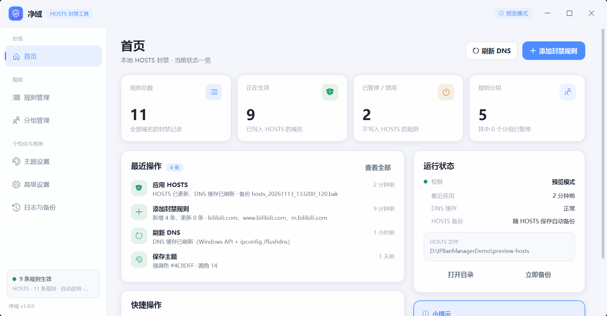
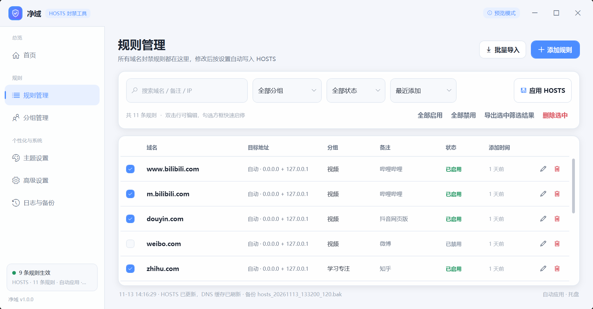
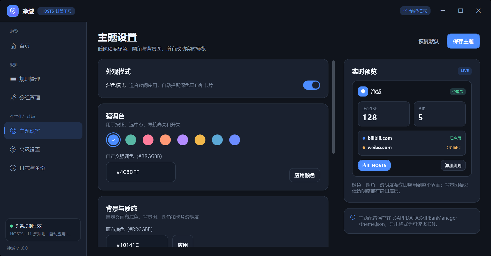
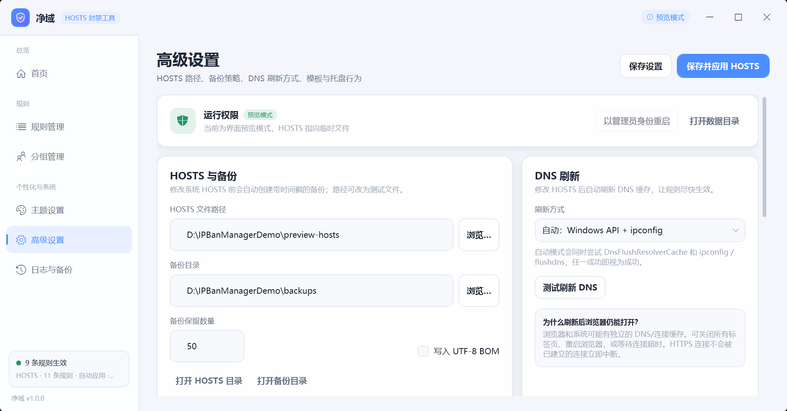
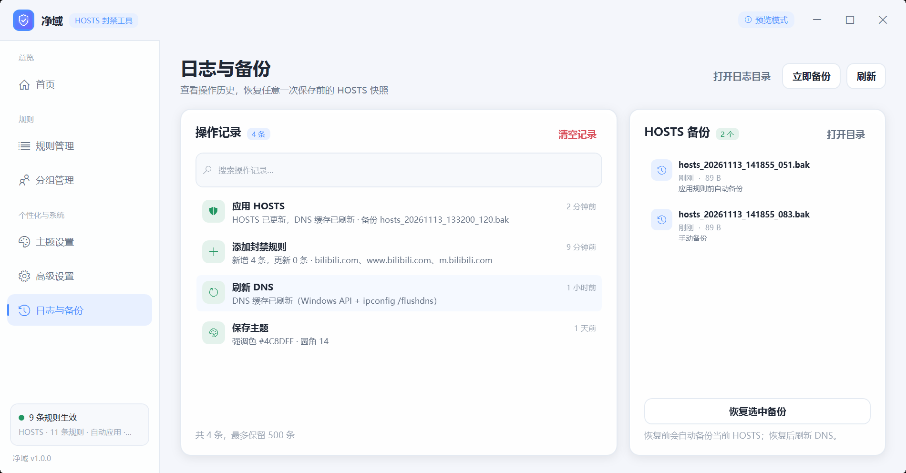
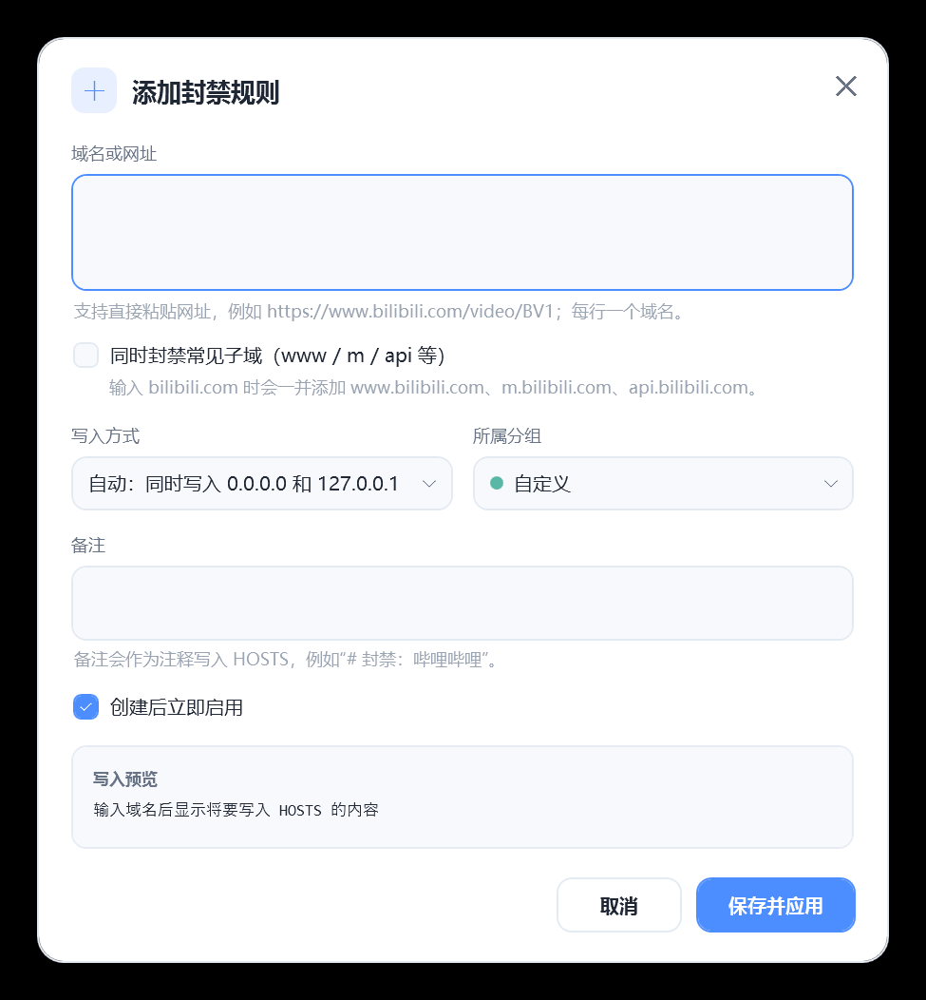
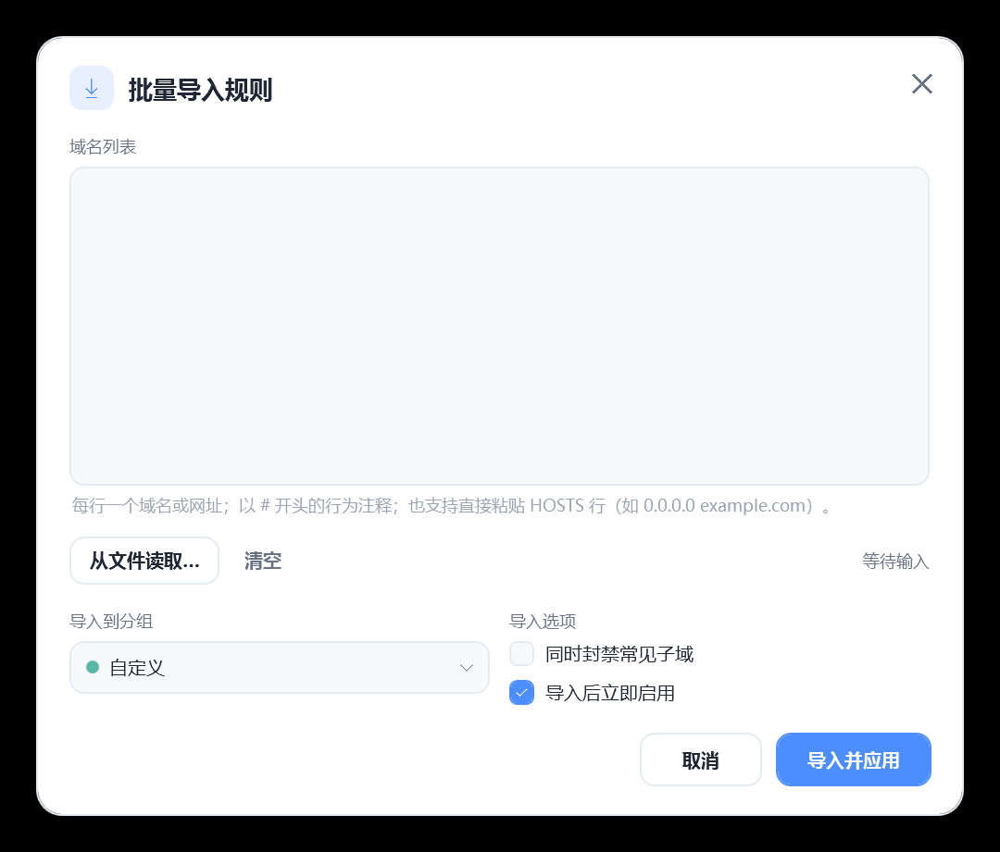

# 净域（IPBanManager）

> 一个轻量、开箱即用的 Windows 本地 HOSTS 封禁工具。用“域名指向本机”的方式，把你想远离的网站挡在 DNS 层之外。

净域（英文名 IPBanManager）基于 **C# + WPF** 开发，目标框架 **.NET Framework 4.8**，**不依赖任何第三方 NuGet 包**。程序通过管理员权限维护一份“托管区域”HOSTS 内容，实现站点封禁、分组管理、一键暂停、主题自定义、备份恢复等能力，同时**永不改写你在 HOSTS 里手写的其他行**。

**下载 / Download**：[GitHub Releases](https://github.com/GB233-grt/IPBanManager/releases/tag/v1.0.0) · [源代码仓库](https://github.com/GB233-grt/IPBanManager)

> 正式版请下载 `IPBanManager-v1.0.0-win-x64.zip`，解压后双击 `IPBanManager.exe`，UAC 提权后使用。界面预览版不需要管理员权限，但只使用临时 HOSTS 文件。

---

## 目录

- [核心特性](#核心特性)
- [界面预览](#界面预览)
- [技术选型理由](#技术选型理由)
- [目录结构](#目录结构)
- [构建方法](#构建方法)
- [发布方式](#发布方式)
- [验证](#验证)
- [数据与文件位置](#数据与文件位置)
- [安全边界](#安全边界)
- [已知限制](#已知限制)
- [文档索引](#文档索引)

---

## 核心特性

### 规则管理

- 规则的**增、删、改、查**：一个域名一条规则，可单独启用/禁用。
- **IP 模式**：`auto` 模式同时写入 `0.0.0.0` 与 `127.0.0.1` 两条映射；`custom` 模式写入你指定的 IP（仅写一条）。
- **重复域名自动更新而非追加**：同一域名再次添加时更新已有规则，不会在 HOSTS 中产生重复行。
- **一键子域扩展**：添加域名时可自动补充常见子域（`www`、`m`、`api`），扩展前缀可配置。
- **搜索、筛选、排序**：按域名/备注搜索，按分组筛选，按启用状态筛选。
- **与用户自有 HOSTS 行共存**：只维护标记块内部；块外你手写的行原样保留。若外部行与托管域名冲突，界面会给出冲突提示。

### 分组与暂停

- 内置分组：**学习专注、游戏、视频、广告、自定义**；可继续新建自定义分组。
- **一键暂停分组**：分组暂停只影响写入 HOSTS 的结果，不改变组内规则自身的启用状态，恢复后原样生效。
- 支持新建、重命名、暂停/恢复；新建分组自动分配颜色；内置分组不可删除（防止误操作丢失规则归属）。

### HOSTS 托管区域

- 用固定标记块托管程序生成内容：

  ```text
  # ==== IPBan Manager 托管区域 开始 ====
  # 由 IPBan Manager 自动生成，请勿手动修改此区域
  # 封禁：哔哩哔哩 [视频]
  0.0.0.0 bilibili.com
  127.0.0.1 bilibili.com
  # ==== IPBan Manager 托管区域 结束 ====
  ```

- 禁用的规则以 `# [已禁用]` 注释形式保留在托管块内，便于查看与恢复。
- 写入前自动备份，**UTF-8 编码**（默认无 BOM，可在设置中切换）；写入优先使用 `File.Replace` 原子替换，不支持时回退覆盖复制，降低半截文件风险。

### DNS 缓存刷新

- 三种模式：`auto`（默认）、`ipconfig`、`api`。
  - `auto`：同时尝试 `DnsFlushResolverCache` 与 `ipconfig /flushdns`，任一成功即视为成功。
  - `api`：调用 `dnsapi.dll` 的 `DnsFlushResolverCache`。
  - `ipconfig`：执行 `ipconfig /flushdns`。
- 刷新失败时明确提示“HOSTS 已保存，但 DNS 刷新失败，请手动刷新”，不会误报成功。

### 日志、备份与恢复

- 每次应用 HOSTS 前自动生成带时间戳的备份文件，默认保留最近 **50** 个（可设置）。
- 操作日志持久化在 `data.json`，首页展示最近操作；文件日志写入 `logs\app-yyyy-MM-dd.log`。
- 支持从备份列表**一键恢复**，恢复前同样会先备份当前 HOSTS。

### 主题自定义

- 强调色、明暗模式、背景图（含透明度）、圆角半径、卡片透明度。
- 主题可**导入/导出**为 JSON，便于分享与备份。
- 设置页实时预览；视觉风格参考 PCL2：浅色低饱和、卡片化、圆角、左侧导航、页面淡入滑动动画、Segoe MDL2 图标、自定义窗口标题栏。

### 系统集成

- 启动 UAC 提权（`requireAdministrator`）；未提权时界面顶部显示提示与“以管理员身份重启”按钮。
- 支持**开机自启**（当前用户，注册表 `Run`，以 `--minimized` 静默启动）。
- 支持**托盘**：最小化到托盘、关闭到托盘（均可关闭）。默认**右上角 X 关闭窗口会隐藏到托盘**，需从托盘菜单“退出净域”才真正退出。
- **高级设置**：HOSTS 路径、备份目录、数据目录（`--data-dir`，便于测试与绿色使用）、模板、自动应用等。

---

## 界面预览

> 截图来自 `asInvoker` 的界面预览构建，因此右上角显示“预览模式”标识；这不代表正式版权限，正式版启动时请求 `requireAdministrator` 提权。截图文件位于 `docs/images/`。



| 页面 | 截图 |
| --- | --- |
| 规则管理 |  |
| 分组管理 |  |
| 主题设置（浅色） |  |
| 主题设置（深色） |  |
| 高级设置 |  |
| 日志与备份 |  |
| 添加规则对话框 |  |
| 批量导入对话框 |  |

---

## 技术选型理由

### 为什么是 C# + WPF + .NET Framework 4.8

- **零运行时安装成本**：Windows 10 1903+ / Windows 11 自带 .NET Framework 4.8，用户无需额外安装 .NET SDK 或运行时；相比之下 .NET 8 需要用户装运行时或做自包含发布。
- **系统自带构建链**：可直接使用 Windows 自带的 **MSBuild 4.0** 编译，不要求安装 .NET SDK、无需联网还原包。
- **无第三方依赖**：JSON 使用 `System.Web.Script.Serialization.JavaScriptSerializer`，托盘使用框架内 `System.Windows.Forms.NotifyIcon`，全部来自 .NET Framework 或 Windows 系统 DLL，杜绝 NuGet 供应链与版本冲突。
- **与 Windows 深度集成**：UAC 清单、注册表自启、`dnsapi.dll` P/Invoke、HOSTS 文件读写都是原生 Win32 能力，WPF 下最直接。
- **界面表现力足够**：WPF 的控件模板、样式、动画、矢量图标足以复刻 PCL2 风格的卡片化界面，不需要引入 UI 框架。

### 与 Tauri / PySide6 对比

| 维度 | 净域（WPF / .NET Framework 4.8） | Tauri（Rust + WebView2） | PySide6（Qt for Python） |
| --- | --- | --- | --- |
| 运行前提 | Win10 1903+/Win11 自带 .NET Framework 4.8 | 需 WebView2 Runtime（多数系统已带）、需打包 Rust 产物 | 需打包 Python 解释器与 Qt，体积大 |
| 发行体积 | 单 exe，约数百 KB～数 MB | 较小，但依赖 WebView2 | 通常 60 MB+ |
| 构建环境 | 系统自带 MSBuild 4.0 即可 | 需 Rust 工具链 + Node 工具链 | 需 Python + PyInstaller/Nuitka |
| 提权与系统 API | 清单直接 `requireAdministrator`；P/Invoke 直接 | 需 Rust 侧命令与权限配合 | 需额外处理 UAC 与 Win32 调用 |
| 依赖风险 | 零 NuGet 依赖 | npm/cargo 依赖树较大 | pip 依赖与打包坑较多 |
| 开发语言一致性 | C#/XAML 单一技术栈 | Rust + 前端双栈 | Python + Qt 双栈 |

结论：本项目核心诉求是“**单文件、免安装、管理员、直连系统 API、可长期离线维护**”，WPF + .NET Framework 4.8 是成本最低且最稳妥的选择。代价是 UI 生态不如 Web 前端灵活，因此视觉实现完全基于 WPF 样式与模板自行搭建。

---

## 目录结构

```text
IPBanManager\
├─ README.md                     本文件
├─ build.ps1                     一键构建：核心测试 → 构建 → 整理发布目录 → 打包 zip
├─ test.ps1                      仅构建并运行核心自动化测试
├─ docs\
│  ├─ 设计文档.md                架构、数据模型、托管块算法、验收标准对照
│  ├─ 用户手册.md                安装、使用、常见问题（同时会复制进发布包）
│  └─ images\                    界面截图（9 张，来自界面预览版）
├─ dist\                         发布产物（构建后生成）
│  ├─ 净域\                      IPBanManager.exe、用户手册.md、快速开始.txt、版本信息.txt
│  ├─ 净域-v1.0.0-win-x64.zip
│  ├─ 净域-界面预览版\            IPBanManager.Preview.exe（asInvoker，仅界面预览）
│  └─ 净域-v1.0.0-界面预览版.zip
├─ tests\CoreTests\              控制台核心逻辑测试（12 项）
└─ src\IPBanManager\
   ├─ IPBanManager.csproj        WPF 工程，net48，x64，无第三方包
   ├─ app.manifest               requireAdministrator
   ├─ app.preview.manifest       asInvoker（仅界面预览构建）
   ├─ App.xaml / App.xaml.cs     启动、单实例、异常兜底、管理员检测、预览模式
   ├─ MainWindow.xaml(.cs)       自定义标题栏、左侧导航、页面容器、Toast、管理员横幅
   ├─ Models\                    BanRule / BanGroup / OperationRecord / AppData / AppSettings / ThemeSettings / RuleEditResult / BatchImportResult
   ├─ Services\                  StoragePaths / JsonHelper / LogService / DomainUtil / RuleService / DataService / BackupManager / HostsManager / DnsService / AdminService / AutoStartService / ThemeManager / TrayService
   ├─ Views\                     DashboardView / RulesView / GroupsView / ThemeView / AdvancedView / LogsView
   ├─ Dialogs\                   ConfirmDialog / PromptDialog / RuleEditDialog / BatchImportDialog
   ├─ ViewModels\                GroupCardItem 等
   ├─ Converters\                CommonConverters
   ├─ Themes\Styles.xaml         全局样式、颜色、控件模板
   └─ Assets\app.ico             应用图标
```

---

## 构建方法

### 环境要求

- Windows 10 1903+ 或 Windows 11（x64）。
- .NET Framework 4.8（系统自带；脚本会检查注册表 `Release >= 528040`）。
- 不需要安装 .NET SDK；使用系统自带的 **MSBuild 4.0**（`%WINDIR%\Microsoft.NET\Framework64\v4.0.30319\MSBuild.exe`）。
- 构建前请先退出正在运行的净域（包括托盘），否则 exe 被占用会导致构建失败。

### 一键构建（推荐）

```powershell
powershell -ExecutionPolicy Bypass -File build.ps1
```

脚本依次执行：**构建并运行核心测试 → 构建主程序 → 整理 `dist\净域\` → 生成 zip**。

可选参数：

| 参数 | 说明 |
| --- | --- |
| `-Configuration Debug` / `Release` | 构建配置，默认 `Release` |
| `-SkipTests` | 跳过核心测试（仅构建） |
| `-NoZip` | 不生成发布 zip |
| `-Preview` | 构建界面预览版（`asInvoker`，HOSTS 指向临时目录） |

产物：

```text
dist\净域\IPBanManager.exe
dist\净域\用户手册.md
dist\净域\快速开始.txt
dist\净域\版本信息.txt          （包含构建时间与 exe 的 SHA256）
dist\净域-v1.0.0-win-x64.zip
```

### 单独运行核心测试

```powershell
powershell -ExecutionPolicy Bypass -File test.ps1
```

等价于用 MSBuild 构建 `tests\CoreTests\CoreTests.csproj` 并运行；退出码 0 表示全部通过，非 0 表示存在失败项。

### 界面预览构建（无需管理员）

```powershell
powershell -ExecutionPolicy Bypass -File build.ps1 -Preview
```

产物：

```text
dist\净域-界面预览版\IPBanManager.Preview.exe
dist\净域-v1.0.0-界面预览版.zip
```

预览构建使用 `app.preview.manifest`（`asInvoker`）和临时数据目录、临时 HOSTS，**不会修改系统 HOSTS**，用于界面检查与截图；正式功能验收请使用正式版。

### 手工构建（等价做法）

```powershell
& "$env:WINDIR\Microsoft.NET\Framework64\v4.0.30319\MSBuild.exe" `
  "src\IPBanManager\IPBanManager.csproj" /p:Configuration=Release
```

输出 `src\IPBanManager\bin\Release\IPBanManager.exe`。

---

## 发布方式

1. 执行 `build.ps1`，得到 `dist\净域-v1.0.0-win-x64.zip`。
2. 将 zip 分发给用户；解压后目录内含 `IPBanManager.exe`、`用户手册.md`、`快速开始.txt`、`版本信息.txt`。
3. 用户双击 `IPBanManager.exe`，在 UAC 提示中选择“是”即可运行（程序清单为 `requireAdministrator`）。
4. 升级时直接覆盖 exe；`%APPDATA%\IPBanManager` 下的数据不会丢失。
5. 校验完整性：`版本信息.txt` 中记录了本次构建的 SHA256。

> 若需要绿色/测试运行，可用 `--data-dir <目录>` 指定独立数据目录，并在高级设置中指定独立的 HOSTS 路径与备份目录。

---

## 验证

- **核心自动化测试：12/12 通过，失败 0。** 覆盖域名/URL 归一化、拒绝 IP 与通配符、常见子域扩展、批量文本解析、规则去重更新、托管块生成、合并时保留用户行、HOSTS UTF-8 读写、备份创建/恢复/保留、完整 Apply 与冲突检测、JSON 数据持久化、设置与主题序列化（`tests\CoreTests`，可用 `test.ps1` 复跑）。
- **Release 构建通过**，产物为 `dist\净域\IPBanManager.exe`，清单为 `requireAdministrator`（已通过 PE 资源提取验证）。
- **界面截图**取自界面预览版（`asInvoker`），右上角显示“预览模式”属于预览构建的正常标识；截图不修改系统 HOSTS。
- **未在真实系统 HOSTS 上做实测**：验收在临时 HOSTS 文件上完成，未改动本机系统 HOSTS；正式版写入系统 HOSTS 的行为需在管理员环境下自行验证。
- **独立 QA 验收**：见 [`tests/QA-REPORT.md`](tests/QA-REPORT.md)。最终发布前已修复 null 数据清理、模板换行清洗、`File.Replace` 回退范围、持久化失败提示等 P2；QA 未发现 P0，P1 为“发布包需在最终源码上重建”，已通过最终构建流程消除。

---

## 数据与文件位置

| 内容 | 位置 |
| --- | --- |
| 数据目录 | `%APPDATA%\IPBanManager`（可用 `--data-dir` 覆盖） |
| 规则/分组/操作记录 | `%APPDATA%\IPBanManager\data.json` |
| 设置 | `%APPDATA%\IPBanManager\settings.json` |
| 主题 | `%APPDATA%\IPBanManager\theme.json` |
| 备份 | `%APPDATA%\IPBanManager\backups\`（可在设置中改目录） |
| 文件日志 | `%APPDATA%\IPBanManager\logs\app-yyyy-MM-dd.log` |
| 背景图等资源 | `%APPDATA%\IPBanManager\assets\` |
| 默认 HOSTS | `C:\Windows\System32\drivers\etc\hosts` |

备份文件命名：`hosts_yyyyMMdd_HHmmss_fff.bak`，同名 `.meta.txt` 记录来源信息。

---

## 安全边界

- 本工具**只修改两样东西**：HOSTS 文件与 DNS 解析缓存。
- **不**修改 Windows 防火墙，**不**安装驱动，**不**改动网络适配器/DNS 服务器设置，**不**代理或拦截流量。
- HOSTS 无法按 IP 层封禁：域名映射到 `0.0.0.0` / `127.0.0.1` 属于 **DNS 层屏蔽**，仅对遵守系统 DNS 解析的应用有效。

---

## 已知限制

1. **域名层级屏蔽，而非网络层封禁**：应用直接使用自定义 DoH/DoT 解析、内置 IP 直连、或系统代理时，HOSTS 不生效。
2. **需要管理员权限**：写入 `C:\Windows\System32\drivers\etc\hosts` 与刷新 DNS 缓存都需要提权，普通权限下只能查看界面。
3. **只覆盖域名**：无法按 IP、端口、进程封禁；同一站点换域名/换 CDN 域名需另行添加规则。
4. **浏览器与系统缓存**：应用自身缓存、连接复用、系统代理可能让封禁延迟生效，刷新 DNS 后建议重启对应应用。
5. **HOSTS 行数过多**会拖慢解析，建议只保留真正需要的规则。
6. **不修改其他 HOSTS 内容**：块外用户行永不改写；若块外存在同域名映射，会提示冲突但不会自动删除用户行。
7. **系统级安全软件**可能拦截对 HOSTS 的写入，需要手动放行。
8. 界面与主题能力受 WPF 限制，不等同于 Web 前端的任意定制。
9. **原 HOSTS 编码会被统一为 UTF-8**：程序能识别 UTF-8/UTF-16/系统 ANSI 输入，但写回时统一使用 UTF-8（默认无 BOM）。块外已有的 ANSI 中文注释文本内容不会丢失，但字节编码会改变，按 ANSI 读取的旧工具可能看到乱码。

---

## 文档索引

- [设计文档](docs/设计文档.md)：功能结构图、界面原型、数据模型、托管块算法、HOSTS/DNS 实现说明、主题方案、权限与异常处理、验收标准对照表。
- [用户手册](docs/用户手册.md)：安装、首次运行、规则与分组、主题、日志与备份恢复、托盘/自启、常见问题。

---

## 许可与致谢

- 界面风格参考 [PCL2](https://github.com/Hex-Dragon/PCL2) 的视觉语言，仅为风格致敬，不含其代码。
- 本项目为本地工具，所有数据保存在本机，不联网上传。
