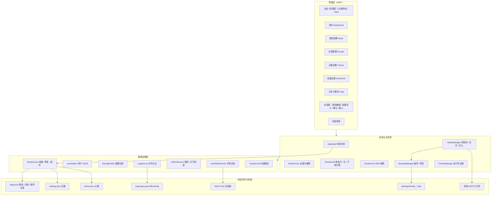
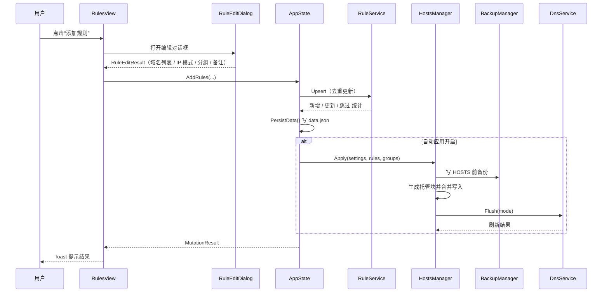
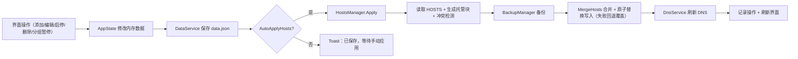

# 净域（IPBanManager）设计文档

| 项目 | 内容 |
| --- | --- |
| 产品名称 | 净域（IPBanManager） |
| 文档版本 | v1.0（随代码同步） |
| 目标平台 | Windows 10 1903+ / Windows 11（x64） |
| 技术栈 | C# + WPF，.NET Framework 4.8，无第三方 NuGet 依赖 |
| 数据目录 | `%APPDATA%\IPBanManager`（可用 `--data-dir` 覆盖） |
| 默认 HOSTS | `C:\Windows\System32\drivers\etc\hosts` |
| 说明 | 本文档描述实现约定；如与源码不一致，**以实现代码为准**。 |

---

## 1. 产品定位与设计目标

净域是一个 Windows 本地 HOSTS 封禁工具。它把用户要屏蔽的域名映射到 `0.0.0.0` / `127.0.0.1`，在 **DNS 解析层**阻止访问，并提供规则管理、分组暂停、主题自定义、备份恢复等配套能力。

设计目标：

1. **安全可控**：只改 HOSTS 与 DNS 缓存，绝不改动防火墙、驱动、网络适配器；块外用户 HOSTS 内容永不改写。
2. **免安装、可离线**：单 exe 运行，只依赖系统自带的 .NET Framework 4.8；构建只用系统自带 MSBuild 4.0。
3. **可恢复**：每次写 HOSTS 前自动备份；恢复前再备份；数据文件损坏可自动修复并保留原文件。
4. **边界清晰**：界面中明确提示“HOSTS 屏蔽不等于网络层封禁”，不夸大能力。
5. **视觉轻盈**：参考 PCL2 的低饱和浅色卡片风格，支持明暗主题与实时预览。

---

## 2. 功能结构图



### 2.1 一次“添加规则”的调用链



---

## 3. 界面原型说明

窗口默认 `1320 × 860`，最小 `1120 × 700`；无系统标题栏，使用 `WindowChrome` 自绘标题栏（56px），左侧导航宽 224px。窗口加载时按 `SystemParameters.WorkArea` 自适应并居中。页面切换使用 200ms 淡入 + 16px 水平滑入动画（`CubicEase / EaseOut`）。

公共区域：

- **标题栏**：左侧应用图标 + “净域” + “HOSTS 封禁工具”标签；右侧“预览模式”胶囊（仅预览构建）、“管理员/未提权”状态胶囊、最小化/最大化/关闭按钮；空白处可拖动，双击最大化。
- **左侧导航**：分组标题“总览 / 规则 / 个性化与系统”，共 6 个导航项（首页、规则管理、分组管理、主题设置、高级设置、日志与备份）；底部状态卡显示“N 条规则生效”和 HOSTS/行为摘要；最底部版本号 `净域 v1.0.0`。
- **管理员横幅**：未提权且非预览模式时出现在内容区顶部，包含“以管理员身份重启”和“暂时忽略”（关闭）按钮；启动时还会弹出一次确认对话框，可选择“以管理员身份重启”或“以只读模式继续”。
- **Toast**：右下角浮层，成功/失败两种图标与配色，约 3.6 秒后自动淡出。

### 3.1 首页（DashboardView）

文件：`src/IPBanManager/Views/DashboardView.xaml`

1. 页头：标题“首页”、副标题“本地 HOSTS 封禁 · 当前状态一览”；右上角“刷新 DNS”“添加封禁规则”按钮。
2. 统计卡（4 张，等宽）：规则总数、正在生效、已暂停/禁用、规则分组；每张含图标徽章、数值、说明文字。
3. 两栏内容：
   - 左栏“最近操作”：最多 8 条操作记录（时间、图标、标题、详情、失败标记），右上角“查看全部”跳转日志页；无记录时显示空状态。
   - 右栏：
     - “快捷操作”：添加规则、立即应用、全部启用、全部禁用（后两者带确认框）。
     - “运行状态”：权限、最近应用、DNS 缓存、HOSTS 备份四行状态；“HOSTS 文件”路径卡（含“打开目录”“立即备份”）。
     - “小提示”：说明 DNS 层屏蔽边界与浏览器缓存影响。

### 3.2 规则管理（RulesView）

文件：`src/IPBanManager/Views/RulesView.xaml`

1. 页头：标题“规则管理”，副标题说明修改后按设置自动写入 HOSTS；右上角“批量导入”“添加规则”。
2. 筛选工具栏：
   - 搜索框（占位符“搜索域名 / 备注 / IP”，匹配域名、备注、分组名、目标地址）；
   - 状态筛选：全部状态 / 仅已启用 / 仅已禁用（按“有效状态”判断，含分组暂停影响）；
   - 分组筛选：全部分组 + 各分组（暂停分组显示“（暂停）”后缀）；
   - 排序：最近添加 / 域名 A → Z / 按分组排序 / 状态优先；
   - “应用 HOSTS”按钮。
3. 批量操作栏：全部启用、全部禁用、导出选中筛选结果、删除选中；右侧显示“共 N 条规则”“双击行可编辑，勾选方框快速启停”。
4. 规则表格（DataGrid）列：域名、目标地址、分组、备注、状态、添加时间（相对时间）、操作（编辑/删除）。
5. 空状态：图标 + “还没有封禁规则” + “添加第一条规则”按钮。
6. 底部状态：显示当前筛选结果数量。

### 3.3 分组管理（GroupsView）

文件：`src/IPBanManager/Views/GroupsView.xaml`

1. 页头：标题“分组管理”，副标题强调“暂停不会改变组内规则自身的启用状态”；右上角“新建分组”。
2. 分组卡片墙：每张卡片显示颜色标识、分组名、规则总数/生效数、启用开关；“查看规则”（跳转规则页并套用该分组筛选）、“重命名”、删除（系统分组不显示删除）。
3. 底部提示卡“关于分组暂停”：说明暂停后组内规则在托管块中被注释、恢复后按原状态写入，默认分组可改名不可删除。

### 3.4 主题设置（ThemeView）

文件：`src/IPBanManager/Views/ThemeView.xaml`

1. 页头：标题“主题设置”，副标题“低饱和度配色、圆角与背景图，所有改动实时预览”；右上角“恢复默认”“保存主题”。
2. 左栏卡片：
   - 外观模式：深色模式开关（切换时自动搭配深色画布）。
   - 强调色：预设色板 + 自定义 `#RRGGBB` 输入 + “应用颜色”。
   - 背景与质感：画布底色 `#RRGGBB` + “应用”；背景图片选择/清除（复制到 `assets\`）；背景图不透明度滑条；圆角强度滑条；卡片透明度滑条。
   - 主题配置：导出主题、导入主题、恢复默认。
3. 右栏“实时预览”：带 LIVE 标签的迷你界面（标题栏、统计卡、两条规则示例），随左侧设置即时变化；下方提示卡说明配置保存位置与导出格式。

### 3.5 高级设置（AdvancedView）

文件：`src/IPBanManager/Views/AdvancedView.xaml`

1. 页头：右上角“保存设置”“保存并应用 HOSTS”。
2. 主体为纵向卡片流：
   - **运行权限**（整行卡片）：当前权限胶囊（管理员/普通权限/预览模式）+ 说明 + “以管理员身份重启” + “打开数据目录”。
   - **HOSTS 与备份**（左，约 1.5 份宽）与 **DNS 刷新**（右，约 1 份宽）并排：
     - HOSTS 与备份：HOSTS 文件路径 + 浏览；备份目录 + 浏览；备份保留数量（1～500）；“写入 UTF-8 BOM”开关；“打开 HOSTS 目录”“打开备份目录”。
     - DNS 刷新：刷新方式下拉（自动：Windows API + ipconfig / 仅 Windows API / 仅 ipconfig /flushdns）、“测试刷新 DNS”、自动模式说明与“为什么刷新后浏览器仍能打开？”提示卡。
   - **HOSTS 模板**（整行卡片）：屏蔽模板（默认 `0.0.0.0 {domain}`）与重定向模板（默认 `127.0.0.1 {domain}`）并排，下方为常见子域扩展前缀与示例预览，以及“自动应用 HOSTS”“批量导入时默认扩展子域”两个开关。
   - **托盘与开机启动**（整行卡片）：左列“启用托盘图标 / 最小化到托盘 / 关闭到托盘”，右列“开机自启 / 启动时最小化”，底部显示当前数据目录。
   - **安全边界提示卡**：说明只修改 HOSTS 与 DNS 缓存。

### 3.6 日志与备份（LogsView）

文件：`src/IPBanManager/Views/LogsView.xaml`

1. 页头：右上角“打开日志目录”“立即备份”“刷新”。
2. 左栏“操作记录”：记录数、“清空记录”、搜索框；列表项含图标、时间、标题、详情、失败标记；无记录时显示空状态。
3. 右栏“HOSTS 备份”：备份数量、“打开目录”、备份列表（文件名、原因、大小、时间）、底部“恢复选中备份”按钮，并提示“恢复前会自动备份当前 HOSTS；恢复后刷新 DNS”。

### 3.7 对话框

| 对话框 | 文件 | 说明 |
| --- | --- | --- |
| 规则编辑 | `Dialogs/RuleEditDialog.xaml` | 添加/编辑规则。字段：域名（多行，支持粘贴多域名/URL）、IP 模式（自动 0.0.0.0 + 127.0.0.1 / 自定义 IP）、分组、备注、启用状态、同时封禁常见子域（仅添加模式）；底部实时预览将写入 HOSTS 的内容 |
| 批量导入 | `Dialogs/BatchImportDialog.xaml` | 多行文本粘贴或读取文件（`*.txt;*.csv;*.list`），选择分组、默认扩展子域、默认启用；实时统计“识别 N 个域名 / 扩展后 N 条 / N 个错误”；单次上限 2000 条 |
| 确认 | `Dialogs/ConfirmDialog.xaml` | 标题、正文、确认/取消文案、危险操作样式 |
| 输入 | `Dialogs/PromptDialog.xaml` | 单行文本输入（新建/重命名分组），带占位提示 |

---

## 4. 技术选型理由

### 4.1 为什么选 C# + WPF + .NET Framework 4.8

| 关注点 | 说明 |
| --- | --- |
| 零运行时安装 | Windows 10 1903+ / Windows 11 自带 .NET Framework 4.8，用户不需要装 .NET SDK 或运行时 |
| 系统自带构建链 | 工程为旧式 csproj（`ToolsVersion="4.0"`），用 `%WINDIR%\Microsoft.NET\Framework64\v4.0.30319\MSBuild.exe` 即可构建，无需联网还原 |
| 无第三方依赖 | JSON 用框架自带 `System.Web.Script.Serialization.JavaScriptSerializer`；托盘用 `System.Windows.Forms.NotifyIcon`；DNS 用 `dnsapi.dll` P/Invoke；全部来自 .NET Framework 或系统 DLL |
| 系统集成直接 | UAC 清单、注册表自启、HOSTS 文件读写、DWM 窗口圆角/深色标题栏都是原生 Win32 能力 |
| 界面能力足够 | WPF 模板/样式/动画/矢量图标可复刻 PCL2 风格，不必引入 UI 框架 |

### 4.2 与 Tauri / PySide6 对比

| 维度 | 净域（WPF / .NET Framework 4.8） | Tauri | PySide6 |
| --- | --- | --- | --- |
| 用户侧运行时 | 系统自带 .NET Framework 4.8 | 需 WebView2，Rust 产物需打包 | 需随包携带 Python + Qt |
| 发行体积 | 单 exe，体积小 | 较小，但依赖 WebView2 | 通常 60 MB 以上 |
| 构建环境 | 系统自带 MSBuild 4.0 | Rust + Node 工具链 | Python + PyInstaller/Nuitka |
| 提权 | 清单 `requireAdministrator`，一步到位 | 需 Rust 侧配合 | 需额外处理 UAC |
| 依赖风险 | 零 NuGet 依赖 | npm/cargo 依赖树大 | pip 依赖多、打包坑多 |
| 技术栈 | C#/XAML 单一栈 | Rust + Web 前端双栈 | Python + Qt 双栈 |

结论：本项目要求“单文件、免安装、管理员、直连系统 API、可离线构建”，WPF + .NET Framework 4.8 的总体成本最低。

### 4.3 工程与依赖

`src/IPBanManager/IPBanManager.csproj` 关键配置：

- `TargetFrameworkVersion`：`v4.8`，`PlatformTarget`：`x64`，`OutputType`：`WinExe`；
- `ApplicationManifest`：`app.manifest`（`requireAdministrator`）；预览构建使用 `app.preview.manifest`（`asInvoker`）且定义 `PREVIEW` 编译常量；
- 引用仅限框架程序集：`System`、`System.Core`、`System.Xaml`、`System.Xml`、`System.Web.Extensions`、`System.Drawing`、`System.Windows.Forms`、`WindowsBase`、`PresentationCore`、`PresentationFramework`；**没有 PackageReference**。

---

## 5. 项目文件结构

```text
网站禁用\
├─ README.md
├─ build.ps1                       一键构建：核心测试 → 构建 → 整理 dist → 打包 zip
├─ test.ps1                        仅构建并运行核心测试
├─ docs\
│  ├─ 设计文档.md
│  ├─ 用户手册.md
│  └─ images\                      界面截图（dashboard/rules/groups/theme/theme-dark/advanced/logs/dialog-rule/dialog-import）
├─ dist\                           发布产物（构建生成）
│  ├─ 净域\                        IPBanManager.exe、用户手册.md、快速开始.txt、版本信息.txt
│  ├─ 净域-v1.0.0-win-x64.zip
│  ├─ 净域-界面预览版\             IPBanManager.Preview.exe（asInvoker）
│  └─ 净域-v1.0.0-界面预览版.zip
├─ src\IPBanManager\
│  ├─ IPBanManager.csproj
│  ├─ app.manifest                 requireAdministrator + PerMonitorV2 DPI
│  ├─ app.preview.manifest         asInvoker（仅预览构建）
│  ├─ App.xaml / App.xaml.cs       应用启动、单实例、异常兜底、预览模式、管理员检测
│  ├─ AppState.cs                  状态中枢：规则/分组/设置/主题/持久化/应用 HOSTS
│  ├─ MainWindow.xaml(.cs)         标题栏、导航、页面容器、Toast、管理员横幅、托盘逻辑
│  ├─ Models\
│  │  ├─ AppData.cs                data.json 根对象（Version/Rules/Groups/Operations）
│  │  ├─ AppSettings.cs            settings.json 设置
│  │  ├─ BanRule.cs                封禁规则
│  │  ├─ BanGroup.cs               分组（含内置分组构造）
│  │  ├─ OperationRecord.cs        操作记录
│  │  ├─ ThemeSettings.cs          theme.json 主题
│  │  └─ RuleEditResult.cs         对话框返回值（RuleEditResult/BatchImportResult/RuleUpdateResult）
│  ├─ Services\
│  │  ├─ StoragePaths.cs           数据目录与子目录
│  │  ├─ JsonHelper.cs             JavaScriptSerializer 封装 + 原子写入 + 编码自动识别
│  │  ├─ DataService.cs            data/settings/theme 加载、默认分组补齐、数据修复
│  │  ├─ LogService.cs             文件日志 app-yyyy-MM-dd.log
│  │  ├─ DomainUtil.cs             域名归一化、IDN、IP 拒绝、子域扩展、批量文本解析
│  │  ├─ RuleService.cs            规则 upsert 去重、单条编辑、批量启停
│  │  ├─ HostsManager.cs           托管块生成、合并、冲突检测、原子替换写入、Apply 编排
│  │  ├─ DnsService.cs             DnsFlushResolverCache + ipconfig /flushdns
│  │  ├─ BackupManager.cs          备份 hosts_*.bak + .meta.txt、列表、恢复、清理
│  │  ├─ AdminService.cs           提权检测/重启、打开目录/记事本
│  │  ├─ AutoStartService.cs       HKCU Run 开机自启
│  │  ├─ ThemeManager.cs           动态资源画刷与圆角、背景图
│  │  └─ TrayService.cs            WinForms NotifyIcon 托盘
│  ├─ Views\                       六个页面（Dashboard/Rules/Groups/Theme/Advanced/Logs）
│  ├─ Dialogs\                     四个对话框
│  ├─ ViewModels\GroupCardItem.cs  分组卡片视图模型
│  ├─ Converters\CommonConverters.cs 状态/颜色/时间/图标等值转换器
│  ├─ Themes\Styles.xaml           全局样式、画刷、控件模板
│  └─ Assets\app.ico / app-256.png 应用图标
├─ tests\CoreTests\                控制台核心逻辑测试（12 项，无第三方测试框架）
└─ _buildtest\                     构建链路验证用临时工程（可删除）
```

> 文件清单更新于实现后期；`docs/images/` 为最终截图目录，早期 `docs/assets/` 临时截图已清理。

---

## 6. 数据模型

### 6.1 实体字段

**BanRule（封禁规则）** `Models/BanRule.cs`

| 字段 | 类型 | 说明 |
| --- | --- | --- |
| Id | string(GUID N) | 主键，新建时生成 |
| Domain | string | 归一化后的 ASCII 域名 |
| IpMode | string | `auto`（默认，写 0.0.0.0 与 127.0.0.1）或 `custom`（写 CustomIp） |
| CustomIp | string | 自定义模式下写入的目标 IP |
| GroupId | string | 分组 Id，默认 `custom` |
| Remark | string | 备注，写入托管块注释标题 |
| Enabled | bool | 规则自身启用状态 |
| CreatedAt / UpdatedAt | DateTime | 创建/更新时间 |

**BanGroup（分组）** `Models/BanGroup.cs`

| 字段 | 类型 | 说明 |
| --- | --- | --- |
| Id | string | 内置分组为固定 Id，自建分组为 GUID |
| Name | string | 分组名 |
| Color | string | `#RRGGBB` 颜色 |
| Enabled | bool | 分组是否生效；false = 逻辑暂停 |
| IsSystem | bool | 系统分组不可删除 |
| SortOrder | int | 排序号 |
| CreatedAt | DateTime | 创建时间 |

内置分组（`BanGroup.CreateBuiltIns()`）：

| Id | 名称 | 颜色 | SortOrder | IsSystem |
| --- | --- | --- | --- | --- |
| study | 学习专注 | `#6C8CFF` | 0 | true |
| game | 游戏 | `#FF9A76` | 1 | true |
| video | 视频 | `#FF7D9C` | 2 | true |
| ad | 广告 | `#B38CFF` | 3 | true |
| custom | 自定义 | `#58B7A5` | 4 | true |

**OperationRecord（操作记录）** `Models/OperationRecord.cs`

| 字段 | 类型 | 说明 |
| --- | --- | --- |
| Time | DateTime | 操作时间 |
| Title | string | 操作标题 |
| Detail | string | 详情 |
| Success | bool | 是否成功 |
| Kind | string | 图标/分类：add/delete/edit/toggle/apply/dns/backup/restore/group/theme/settings/error 等 |

**AppData（data.json 根）** `Models/AppData.cs`：`Version`（当前 1）、`Rules`、`Groups`、`Operations` 三个 `ObservableCollection`。

**AppSettings（settings.json）** `Models/AppSettings.cs` 主要字段：

| 字段 | 默认值 | 说明 |
| --- | --- | --- |
| HostsPath | 系统 HOSTS 路径 | 可在高级设置中修改（测试/绿色使用） |
| BackupDirectory | 空 → 数据目录 `backups\` | 备份目录 |
| DnsFlushMode | `auto` | `auto` / `api` / `ipconfig` |
| BlockTemplate | `0.0.0.0 {domain}` | 屏蔽模板 |
| RedirectTemplate | `127.0.0.1 {domain}` | 重定向模板 |
| AutoExpandSubdomains | false | 批量导入时默认扩展子域 |
| ExpansionPrefixes | `www,m,api` | 子域扩展前缀（逗号分隔） |
| AutoApplyHosts | true | 规则变化后自动应用 HOSTS |
| WriteUtf8Bom | false | HOSTS 是否写 UTF-8 BOM |
| BackupRetention | 50 | 备份保留数量（1～500） |
| TrayEnabled | true | 启用托盘 |
| MinimizeToTray | true | 最小化到托盘 |
| CloseToTray | true | 关闭到托盘 |
| StartWithWindows | false | 开机自启 |
| StartMinimized | false | 启动时最小化 |
| MaxLogRecords | 500 | 操作记录上限（50～2000） |

**ThemeSettings（theme.json）** `Models/ThemeSettings.cs`

| 字段 | 默认值 | 说明 |
| --- | --- | --- |
| isDark | false | 深色模式 |
| accentColor | `#4C8DFF` | 强调色 |
| backgroundColor | `#F4F6FB`（深色 `#10141C`） | 画布底色 |
| cornerRadius | 14 | 圆角 0～24 |
| cardOpacity | 0.96 | 卡片透明度 0.55～1.0 |
| backgroundImagePath | 空 | 背景图路径（复制到 `assets\`） |
| backgroundImageOpacity | 0.18 | 背景图不透明度 0.03～0.8 |

### 6.2 持久化格式

- 格式：JSON，UTF-8 无 BOM，`JavaScriptSerializer` 序列化；`MaxJsonLength = int.MaxValue`。
- 写入：先写同目录 `*.tmp` 临时文件，再用 `File.Replace` 替换；替换失败时退化为 `File.Copy`，最后清理临时文件。
- 读取容错：
  - `data.json` 解析失败 → 复制为 `data.json.corrupt-yyyyMMdd-HHmmss.json` 保留现场，然后重置为空数据；
  - `settings.json` / `theme.json` 失败 → 使用默认值；
  - 加载后自动修复：补齐内置分组、修正非法域名/非法自定义 IP、补全缺失 GroupId、去掉重复域名规则、把操作记录裁剪到上限。
- 编码识别（`JsonHelper.DecodeText`）：UTF-8 BOM → UTF-16 LE/BE BOM → 严格 UTF-8 → 系统 ANSI（`Encoding.Default`）。

### 6.3 数据目录结构

```text
%APPDATA%\IPBanManager\
├─ data.json          规则、分组、操作记录
├─ settings.json      设置
├─ theme.json         主题
├─ backups\           hosts_yyyyMMdd_HHmmss_fff.bak + 同名 .meta.txt
├─ logs\              app-yyyy-MM-dd.log
└─ assets\            背景图等资源
```

`--data-dir <目录>` 可整体替换数据根；`--minimized` 启动时隐藏到托盘。

---

## 7. 核心代码实现说明

### 7.1 启动与单实例（`App.xaml.cs`）

启动流程：注册全局异常处理 → 解析命令行（`--data-dir`、`--minimized`）→ 预览模式下切换临时数据目录 → 以命名 Mutex 保证单实例 → 初始化数据目录 → 检测管理员权限 → 加载 data/settings/theme → 应用主题 → 创建并显示主窗口 → 按设置隐藏到托盘 → 数据修复提示 → 未提权时弹出管理员提示。

```csharp
// src/IPBanManager/App.xaml.cs（节选）
string mutexName = IsPreview ? "Local\\IPBanManagerPreview_SingleInstance"
                             : "Local\\IPBanManager_SingleInstance";
bool createdNew;
_singleInstanceMutex = new Mutex(true, mutexName, out createdNew);
if (!createdNew)
{
    MessageBox.Show("净域已经在运行中，请从任务栏托盘打开。", "净域",
        MessageBoxButton.OK, MessageBoxImage.Information);
    Shutdown();
    return;
}
```

管理员检测在 `AdminService.IsElevated()` 中用 `WindowsPrincipal.IsInRole(WindowsBuiltInRole.Administrator)` 实现；提权重启用 `ProcessStartInfo.Verb = "runas"`。

### 7.2 状态中枢（`AppState.cs`）

UI 只调用 `AppState` 的方法，保证顺序统一为：**修改内存数据 → 持久化 data.json → 可选自动应用 HOSTS → 记录操作 → 通知界面刷新**。以“添加规则”为例：

```csharp
// src/IPBanManager/AppState.cs（节选）
public MutationResult AddRules(IEnumerable<string> domains, string ipMode, string customIp,
    string groupId, string remark, bool enabled)
{
    MutationResult mutation = new MutationResult();
    UpsertResult result = RuleService.Upsert(Data.Rules, domains, ipMode, customIp, groupId, remark, enabled);
    mutation.Upsert = result;

    if (result.Added + result.Updated > 0)
    {
        RecordOperation("添加封禁规则", result.Summary + " · " + preview, true, "add");
        PersistData();
        if (Settings.AutoApplyHosts) mutation.Hosts = ApplyHosts();
        NotifyDataChanged();
    }
    // ... 错误路径返回 mutation.Error
}
```

统计口径：`EnabledRuleCount` 使用 `HostsManager.IsEffectivelyEnabled`（规则启用且所属分组启用）；`RecentOperations` 始终保留最近 8 条供首页展示；`RecordOperation` 同时写 `data.json` 操作记录与文件日志。

`ClearLastOperationError()` 用于在编辑前清除上次错误（编辑失败通过 `LastOperationError` 传递，规则页在编辑前调用它）。

### 7.3 域名归一化与子域扩展（`DomainUtil.cs`）

- 支持输入域名、URL、带端口/路径的地址；统一小写、去掉结尾点、非 ASCII 域名转 Punycode（`IdnMapping.GetAscii`）。
- 明确拒绝：IP、通配符 `*.`、无点域名、含下划线的非法标签、超长域名。
- 常见子域扩展：输入 `bilibili.com` + 前缀 `www,m,api` → 生成 `bilibili.com`、`www.bilibili.com`、`m.bilibili.com`、`api.bilibili.com`；输入 `www.bilibili.com` 会先回到根域名再扩展。
- 批量文本解析：忽略 `#` 注释，支持每行一个域名、逗号/分号/空白分隔、以及 `0.0.0.0 example.com` 这类 HOSTS 行（IP 目标被跳过）。

```csharp
// src/IPBanManager/Services/DomainUtil.cs（节选）
if (raw.StartsWith("*.", StringComparison.Ordinal))
{
    error = "HOSTS 不支持通配符，请填写具体域名（可勾选“同时封禁常见子域”）";
    return false;
}
IPAddress address;
if (IPAddress.TryParse(host, out address))
{
    error = "HOSTS 只能屏蔽域名，不能直接按 IP 屏蔽。请填写域名或网址";
    return false;
}
```

### 7.4 规则去重与更新（`RuleService.cs`）

- `Upsert`：按域名大小写不敏感查找，已存在则**更新 IP 模式、分组、备注（非空时）、启用状态与更新时间**，不存在才新增，从根上避免 HOSTS 重复行。
- `UpdateSingle`：编辑时如果域名与其他规则重复则拒绝并提示。
- 目标 IP 校验：`custom` 模式必须能解析为 `IPAddress`，否则报错；`auto` 模式自动清空 `CustomIp`。

```csharp
// src/IPBanManager/Services/RuleService.cs（节选）
BanRule existing = FindByDomain(rules, domain);
if (existing != null)
{
    existing.Domain = domain;
    existing.IpMode = mode;
    existing.CustomIp = customIp;
    existing.GroupId = string.IsNullOrEmpty(groupId) ? "custom" : groupId;
    if (!string.IsNullOrEmpty(remark)) existing.Remark = remark;
    existing.Enabled = enabled;
    existing.UpdatedAt = DateTime.Now;
    result.Updated++;
}
```

### 7.5 HOSTS 托管块生成（`HostsManager.BuildManagedBlock`）

算法：

1. 建立分组 Id → 分组映射；规则按“分组 SortOrder → 域名”排序。
2. 逐个校验域名（无效域名在块内写 `# [无效域名] ...` 注释，不阻断其它规则）。
3. 域名去重（大小写不敏感）：同一域名只输出一次。
4. 计算有效状态：`effective = rule.Enabled && group.Enabled`（分组不存在时视为启用）。
5. 生成注释标题：
   - 启用：`# 封禁：{备注或域名} [{分组名}]`，随后输出映射行；
   - 禁用/组暂停：`# [已禁用] {备注或域名} [{分组名}]`，映射行前统一加 `# ` 注释保留。
6. 映射行由模板渲染：`auto` 模式生成两条（`BlockTemplate` 的 0.0.0.0 行 + `RedirectTemplate` 的 127.0.0.1 行，内容相同则合并为一条）；`custom` 模式生成一条（IP 非法时回退 `0.0.0.0`）。
7. 输出以开始/结束标记包裹，使用 `\r\n` 换行；注释内容中的 `#` 替换为全角 `＃`、换行替换为空格，避免破坏 HOSTS 结构。

```csharp
// src/IPBanManager/Services/HostsManager.cs（节选）
lines.Add(StartMarker);
lines.Add("# 由 IPBan Manager 自动生成，请勿手动修改此区域");
lines.Add("# 生成时间：" + DateTime.Now.ToString("yyyy-MM-dd HH:mm:ss"));
...
bool effective = rule.Enabled && (group == null || group.Enabled);
if (effective)
{
    lines.Add("# 封禁：" + title + " [" + groupName + "]");
    // 写入映射行
}
else
{
    lines.Add("# [已禁用] " + title + " [" + groupName + "]");
    // 映射行加 "# " 前缀
}
```

### 7.6 HOSTS 合并与用户内容保护（`HostsManager.MergeHosts`）

1. 统一换行后逐行扫描，跳过上次托管块（开始标记到结束标记之间）的所有行。
2. 块外内容原样保留；行尾多余空行会被裁剪。
3. 将新托管块追加到块外内容之后，用一个空行分隔；块为空（无规则）时只写块外内容。
4. 若 HOSTS 中存在开始标记但缺少结束标记，按“从开始标记到文件末尾都属于托管区”保守处理，并写警告日志。

```csharp
// src/IPBanManager/Services/HostsManager.cs（节选）
for (int i = 0; i < lines.Length; i++)
{
    string trimmed = lines[i].Trim();
    if (!inManaged && string.Equals(trimmed, StartMarker, StringComparison.Ordinal))
    { inManaged = true; foundStart = true; continue; }
    if (inManaged && string.Equals(trimmed, EndMarker, StringComparison.Ordinal))
    { inManaged = false; foundEnd = true; continue; }
    if (inManaged) continue;
    outside.Add(lines[i]);
}
```

冲突检测（`FindUnmanagedConflicts`）：扫描块外非注释行，解析形如 `IP 域名1 域名2` 的行；若域名命中规则集合，则收集为冲突并随结果返回，界面以 Toast 提示“HOSTS 块外存在同域名记录”，但**不会删除用户行**。

### 7.7 HOSTS 读写编码与原子替换

- 读取：`File.ReadAllBytes` + `JsonHelper.DecodeText`，自动识别 UTF-8 / UTF-16 LE/BE / 系统 ANSI；文件不存在返回空字符串。
- 写入：默认 UTF-8 无 BOM（`new UTF8Encoding(false)`），可在高级设置开启 BOM。先写同目录临时文件 `hosts.ipban-<GUID>.tmp`：
  - 目标文件已存在时，优先 `File.Replace`（NTFS 上为原子替换，避免出现半截 HOSTS）；仅在 `File.Replace` 抛出 `IOException`（文件系统不支持）时回退 `File.Copy` 覆盖；
  - 目标文件不存在时使用 `File.Move`；
  - 写入前记录原文件属性，替换后恢复（并清除只读位）；最后清理临时文件。
- 只读属性检查：若 HOSTS 带只读属性，抛出明确异常“HOSTS 文件是只读属性，请先取消只读后再试”。

```csharp
// src/IPBanManager/Services/HostsManager.cs（节选）
File.WriteAllText(temp, content, encoding);

if (File.Exists(path))
{
    bool replaced = false;
    try
    {
        // 同目录 File.Replace 在 NTFS 上是原子替换，避免出现半截 HOSTS。
        File.Replace(temp, path, null);
        replaced = true;
    }
    catch (IOException)
    {
        // 少数文件系统不支持 Replace 时退回到覆盖复制。
    }

    if (!replaced) File.Copy(temp, path, true);
}
else
{
    File.Move(temp, path);
}
```

### 7.8 Apply 编排与结果模型

`HostsManager.Apply` 的完整顺序：

1. 读取现有 HOSTS（失败则返回错误，权限不足标记 `RequiresElevation`）。
2. 生成托管块并统计启用/禁用数量。
3. 检测块外冲突。
4. 若 HOSTS 文件存在则先创建备份（备份失败即中止修改，保证可回滚）。
5. 合并并写入（失败中止，不刷新 DNS）。
6. 清理超出保留数量的旧备份。
7. 刷新 DNS（失败时返回“HOSTS 已保存，但 DNS 刷新失败，请手动刷新”）。

`HostsApplyResult` 字段：`Success`、`RequiresElevation`、`DnsSuccess`、`Message`、`Error`、`BackupPath`、`DnsDetail`、`Conflicts`、`ActiveRuleCount`、`DisabledRuleCount`、`AppliedAt`。

---

## 8. HOSTS 读写与 DNS 刷新代码说明

### 8.1 托管区域格式

```text
# ==== IPBan Manager 托管区域 开始 ====
# 由 IPBan Manager 自动生成，请勿手动修改此区域
# 生成时间：2026-11-13 13:00:00

# 封禁：哔哩哔哩 [视频]
0.0.0.0 bilibili.com
127.0.0.1 bilibili.com

# [已禁用] 微博 [视频]
# 0.0.0.0 weibo.com
# 127.0.0.1 weibo.com

# ==== IPBan Manager 托管区域 结束 ====
```

标记常量定义在 `HostsManager`：

```csharp
public const string StartMarker = "# ==== IPBan Manager 托管区域 开始 ====";
public const string EndMarker   = "# ==== IPBan Manager 托管区域 结束 ====";
```

### 8.2 DNS 刷新（`DnsService.cs`）

三种模式：

- `auto`（默认）：同时执行 Windows API 与 `ipconfig /flushdns`，任一成功即成功；
- `api`：仅调用 `dnsapi.dll!DnsFlushResolverCache`；
- `ipconfig`：仅执行 `ipconfig.exe /flushdns`（隐藏窗口、重定向输出、8 秒超时后结束进程）。

```csharp
// src/IPBanManager/Services/DnsService.cs（节选）
[DllImport("dnsapi.dll", EntryPoint = "DnsFlushResolverCache", SetLastError = true)]
private static extern bool DnsFlushResolverCache();
...
result.Success = (useApi && result.ApiOk) || (useIpconfig && result.IpconfigOk);
```

结果文案：

- 成功：“HOSTS 已更新，DNS 缓存已刷新”（Apply 场景）或“DNS 缓存已刷新（方法）”（单独刷新场景）；
- 失败：“HOSTS 已保存，但 DNS 刷新失败，请手动刷新”/“DNS 刷新失败，请手动执行 ipconfig /flushdns”。

### 8.3 备份与恢复（`BackupManager.cs`）

- 文件名：`hosts_yyyyMMdd_HHmmss_fff.bak`，同名冲突时追加 `_1`、`_2` 后缀。
- 元数据：同名 `.meta.txt`，记录来源、时间、原因（如“应用规则前自动备份”“手动备份”“恢复前自动备份：xxx”）。
- 恢复：先把当前 HOSTS 再备份一次，再覆盖恢复，随后刷新 DNS；**规则数据不随备份回滚**（备份只含 HOSTS）。
- 清理：按时间倒序保留最近 `BackupRetention` 个（默认 50），删除时连同 `.meta.txt` 一起删除。

```csharp
// src/IPBanManager/Services/BackupManager.cs（节选）
string stamp = DateTime.Now.ToString("yyyyMMdd_HHmmss_fff");
string fileName = "hosts_" + stamp + ".bak";
...
File.Copy(hostsPath, target, false);
```

### 8.4 运行时写 HOSTS 的完整链路



---

## 9. 主题自定义方案（`ThemeManager.cs` + `Styles.xaml` + `ThemeView`）

### 9.1 设计思路

- 所有页面颜色不写死，统一通过 `DynamicResource` 引用应用级资源字典中的画刷；主题变化时只替换资源值，页面无需重建，因此滑条拖动可实时预览。
- `ThemeManager.Apply(theme)` 由主题配置计算出一整套派生色：强调色、强调悬停/按下/柔和色、文字色、副文字色、弱化文字、边框色、分隔线、输入框背景、行悬停色、危险/成功/警告色及其柔和色、滚动条颜色、窗口边框、图标柔和色、阴影色。
- 圆角同时输出三个资源：`CardRadius`（=cornerRadius）、`ControlRadius`（-4，最小 5）、`SmallRadius`（-8，最小 4）。
- 深色模式下，强调色文字颜色根据亮度自动选择黑/白（`ColorUtil.Luminance`）。
- 卡片透明度作用于 `SurfaceBrush` 与 `NavBackgroundBrush` 的 Alpha 通道（后者为卡片 Alpha × 0.9）。

```csharp
// src/IPBanManager/Services/ThemeManager.cs（节选）
byte cardAlpha = (byte)Math.Round(255 * theme.CardOpacity);
Color surfaceWithAlpha = Color.FromArgb(cardAlpha, surface.R, surface.G, surface.B);
Color navWithAlpha = Color.FromArgb(
    (byte)Math.Min(255, Math.Round(cardAlpha * 0.90)), surface.R, surface.G, surface.B);

ResourceDictionary resources = Application.Current.Resources;
Set(resources, "AccentBrush", Solid(accent));
Set(resources, "SurfaceBrush", Solid(surfaceWithAlpha));
resources["CardRadius"] = new CornerRadius(theme.CornerRadius);
```

### 9.2 主题资源键（部分）

| 类别 | 资源键 |
| --- | --- |
| 背景/表面 | `AppBackgroundBrush`、`SurfaceBrush`、`SurfaceSolidBrush`、`NavBackgroundBrush`、`InputBackgroundBrush` |
| 文字 | `TextBrush`、`SubTextBrush`、`MutedTextBrush` |
| 边框/分隔 | `BorderBrush`、`DividerBrush`、`WindowBorderBrush` |
| 强调色 | `AccentBrush`、`AccentHoverBrush`、`AccentPressedBrush`、`AccentSoftBrush`、`AccentTextBrush` |
| 状态色 | `DangerBrush`、`DangerSoftBrush`、`SuccessBrush`、`SuccessSoftBrush`、`WarningBrush`、`WarningSoftBrush` |
| 交互 | `RowHoverBrush`、`ScrollThumbBrush`、`ScrollTrackBrush`、`IconSoftBrush` |
| 圆角 | `CardRadius`、`ControlRadius`、`SmallRadius` |
| 其他 | `IsDarkTheme`、`ShadowColor` |

### 9.3 背景图

- 选择图片后复制到 `%APPDATA%\IPBanManager\assets\bg_yyyyMMdd_HHmmss_<6位随机>.<扩展名>`，主题只保存最终路径。
- `MainWindow.ApplyWindowBackground()` 用 `BitmapImage`（`CacheOption = OnLoad` + `Freeze`）加载，设置到窗口底层 `BackgroundImageLayer` 的 `ImageBrush`，透明度取 `BackgroundImageOpacity`；加载失败时清空背景并写警告日志。
- 文件选择器过滤 JPG / JPEG / PNG / BMP；主题页文案另提到 WebP，实际可选项以对话框过滤与系统解码器为准。

### 9.4 导入/导出与校验

- 导出：`SaveFileDialog` 选择 `*.json`，内容即 `ThemeSettings` 序列化。
- 导入：`DataService.ImportTheme` 读取并 `Normalize()`，立即应用并保存；空文件或格式错误抛出明确异常。
- `Normalize()` 边界：圆角 0～24、卡片透明度 0.55～1.0、背景图透明度 0.03～0.8、空值回退默认；颜色按 `#RRGGBB` 解析失败时回退默认色。

---

## 10. 权限与安全边界

### 10.1 权限模型

| 场景 | 行为 |
| --- | --- |
| 正常启动 | 清单 `requireAdministrator`，UAC 提权后运行 |
| 用户取消 UAC | Windows 阻止启动（清单强制） |
| 以普通权限运行（如预览构建/特殊启动方式） | 顶栏“未提权”胶囊 + 内容区管理员横幅 + 启动时确认框；“以只读模式继续”后可浏览规则，写入/恢复/刷新会失败并提示重启提权 |
| 提权重启 | `ProcessStartInfo.Verb = "runas"` 重新启动自身，成功则退出当前实例 |
| 关闭窗口（默认） | `CloseToTray=true` 且托盘启用时，`MainWindow.OnClosing` 取消关闭并隐藏到托盘；需托盘菜单“退出净域”才真正退出 |
| 开机自启 | 写 `HKCU\Software\Microsoft\Windows\CurrentVersion\Run`，值名 `IPBanManager`，命令 `"exe路径" --minimized`，不需要管理员权限 |
| 预览构建 | `app.preview.manifest` 为 `asInvoker`，`PREVIEW` 常量生效：数据目录切到临时目录、HOSTS 指向临时 `preview-hosts`、注入示例规则，**不会碰系统 HOSTS** |

### 10.2 安全边界

- 只修改：HOSTS 文件、DNS 解析缓存。
- 不修改：Windows 防火墙、驱动、网络适配器、系统 DNS 服务器设置、代理设置。
- 不联网：无更新检查、无遥测、无远端请求。
- HOSTS 能力边界：只能做“域名 → IP”映射，**无法按 IP 层封禁**；对使用自定义 DoH/DoT、直连 IP、系统代理的应用可能无效；不能阻断已建立的 HTTPS 连接。
- 块外用户行永不改写；块外同域名冲突只提示，不自动删除。

---

## 11. 异常处理与容错

| 场景 | 处理方式 |
| --- | --- |
| 界面线程未处理异常 | `DispatcherUnhandledException` 记录日志 + Toast，标记已处理，程序不退出 |
| 非界面线程未处理异常 | `AppDomain.UnhandledException` 记录日志 |
| 启动失败 | 记录日志，弹窗提示错误与日志路径，然后退出 |
| data.json 损坏 | 保留 `*.corrupt-时间戳.json`，重置数据，启动后 Toast 提示“数据已自动修复” |
| settings/theme 损坏 | 回退默认值，写错误日志 |
| 数据不一致 | 加载时补齐内置分组、修正非法域名/IP、补 GroupId、去重、裁剪日志 |
| HOSTS 读取失败 | 区分权限异常（标记需提权）与其它异常，返回明确文案 |
| HOSTS 备份失败 | **中止本次写入**，避免无法回滚的修改 |
| HOSTS 写入失败 | 返回错误；权限问题引导提权重启 |
| HOSTS 只读 | 明确提示“请先取消只读” |
| 托管块缺结束标记 | 保守按文件末尾处理 + 警告日志 |
| DNS 刷新失败 | HOSTS 仍视为保存成功，文案明确区分；可手动刷新 |
| 备份目录不可用 | 设置保存时提示，回退到默认备份目录 |
| 日志写入失败 | 静默忽略，不影响主流程 |
| 背景图加载失败 | 清空背景图效果 + 警告日志 |
| 单实例 | 第二个实例提示“净域已经在运行中”并退出 |

日志：文件 `logs\app-yyyy-MM-dd.log`，格式 `[yyyy-MM-dd HH:mm:ss.fff] [LEVEL] 消息`，LEVE 为 INFO/WARN/ERROR；异常时追加完整堆栈。界面操作记录另存于 `data.json`（默认最多 500 条，首页显示最近 8 条）。

---

## 12. 打包发布方式

### 12.1 构建前置检查（`build.ps1`）

`build.ps1` 在构建前会：

1. 定位系统自带 MSBuild：`%WINDIR%\Microsoft.NET\Framework64\v4.0.30319\MSBuild.exe`，缺失则报错；
2. 读取注册表 `HKLM:\SOFTWARE\Microsoft\NET Framework Setup\NDP\v4\Full`，要求 `Release >= 528040`（.NET Framework 4.8）；
3. 检测 `IPBanManager` / `IPBanManager.Preview` 进程，若仍在运行（含托盘）则提示先退出，避免 exe 被占用；
4. 默认先构建并运行 `tests\CoreTests`，测试退出码非 0 时中止发布构建。

### 12.2 正式版构建

```powershell
powershell -ExecutionPolicy Bypass -File build.ps1
```

可带参数：`-Configuration Debug|Release`、`-SkipTests`、`-NoZip`。流程：构建测试 → 构建主程序 → 重建 `dist\净域\` → 复制 exe/用户手册 → 生成 `快速开始.txt`、`版本信息.txt`（含 SHA256）→ 生成 zip。

产物：

```text
dist\净域\IPBanManager.exe          正式版，requireAdministrator
dist\净域\用户手册.md
dist\净域\快速开始.txt
dist\净域\版本信息.txt              构建时间、配置、SHA256
dist\净域-v1.0.0-win-x64.zip
```

### 12.3 界面预览版构建

```powershell
powershell -ExecutionPolicy Bypass -File build.ps1 -Preview
```

使用 `/p:PreviewBuild=true`：清单切换为 `app.preview.manifest`（`asInvoker`），定义 `PREVIEW` 常量，输出 `bin\Preview\IPBanManager.Preview.exe`。整理为 `dist\净域-界面预览版\` 并生成 `dist\净域-v1.0.0-界面预览版.zip`。预览版使用临时数据目录与临时 HOSTS，**不修改系统 HOSTS**，仅用于界面验收与截图。

### 12.4 单独运行核心测试

```powershell
powershell -ExecutionPolicy Bypass -File test.ps1
```

构建 `tests\CoreTests` 并运行，退出码 0 表示全部通过。当前共 12 项测试，覆盖：域名/URL 归一化、拒绝 IP 与通配符、子域扩展、批量文本解析、规则去重更新、托管块生成、合并保留用户行、HOSTS UTF-8 读写、备份创建/恢复/保留、完整 Apply 与冲突检测、JSON 持久化、设置与主题序列化。

### 12.5 手工构建（不依赖脚本）

```powershell
& "$env:WINDIR\Microsoft.NET\Framework64\v4.0.30319\MSBuild.exe" `
  "src\IPBanManager\IPBanManager.csproj" /p:Configuration=Release
```

输出 `src\IPBanManager\bin\Release\IPBanManager.exe`；预览版加 `/p:PreviewBuild=true`，输出 `bin\Preview\IPBanManager.Preview.exe`。

### 12.6 分发与升级

- 分发 `dist\净域-v1.0.0-win-x64.zip`；用户解压后双击 exe，由 UAC 提权。
- `版本信息.txt` 可用于核对 SHA256。
- 升级覆盖 exe 即可，`%APPDATA%\IPBanManager` 数据保留。
- 目标机只需 .NET Framework 4.8（Windows 10 1903+/11 自带），无需 .NET SDK、无需联网。

---

## 13. 验收标准对照表

| # | 需求 | 实现位置 | 验证方式 | 状态 |
| --- | --- | --- | --- | --- |
| 1 | 规则增删改查 | `AppState.cs`、`RuleService.cs`、`RulesView` | 界面添加/编辑/删除/搜索 | 已实现 |
| 2 | 规则启用/禁用 | `RulesView` 复选框、`AppState.SetRuleEnabled` | 切换后 HOSTS 对应行注释/恢复 | 已实现 |
| 3 | 分组（5 内置 + 自建） | `BanGroup.CreateBuiltIns`、`GroupsView` | 新建/重命名/暂停恢复/删除自建分组；新建自动分配颜色，内置分组不可删 | 已实现 |
| 4 | 一键暂停分组 | `AppState.SetGroupEnabled`、`HostsManager` 有效状态判断 | 暂停后托管块内规则被注释，规则 Enabled 不变 | 已实现 |
| 5 | 搜索/筛选/排序 | `RulesView.xaml.cs`（FilterRule + RuleComparer） | 搜索域名/备注/IP，四种排序 | 已实现 |
| 6 | 批量导入 | `BatchImportDialog`、`DomainUtil.ParseBatchText` | 粘贴/读取文件，识别统计与错误提示 | 已实现 |
| 7 | 规则导出 | `RulesView.Export_Click` | 导出制表符分隔文本（含表头） | 已实现 |
| 8 | 子域扩展（可配置） | `DomainUtil.ExpandDomains`、高级设置前缀 | 勾选后生成 www/m/api 规则 | 已实现 |
| 9 | HOSTS 托管区域 | `HostsManager.BuildManagedBlock` | 检查块标记与内容 | 已实现 |
| 10 | 保存前自动备份 | `BackupManager.CreateBackup` | 每次 Apply 前生成 .bak + .meta.txt | 已实现 |
| 11 | UTF-8 编码 | `HostsManager.WriteHosts`、设置 BOM | 写入后文件编码检查 | 已实现 |
| 12 | 重复域名更新而非追加 | `RuleService.Upsert` | 重复添加后规则数不变 | 已实现 |
| 13 | 与用户 HOSTS 共存 | `HostsManager.MergeHosts` | 块外内容保持不变 | 已实现 |
| 14 | 冲突检测 | `HostsManager.FindUnmanagedConflicts` | 块外同域名时提示 | 已实现 |
| 15 | DNS 刷新三模式 | `DnsService.Flush`、高级设置 | 分别测试 auto/api/ipconfig | 已实现 |
| 16 | 操作日志 | `LogService`、`AppState.RecordOperation` | 日志页与文件日志 | 已实现 |
| 17 | 备份恢复 | `BackupManager.RestoreBackup`、`LogsView` | 恢复前自动备份、恢复后刷新 DNS | 已实现 |
| 18 | 主题自定义 | `ThemeManager`、`ThemeView`、`Styles.xaml` | 改色/圆角/透明度/背景图实时生效 | 已实现 |
| 19 | 主题导入导出 | `DataService.ExportTheme/ImportTheme` | 导出 JSON 再导入 | 已实现 |
| 20 | 开机自启 | `AutoStartService` | 检查 HKCU Run 值 | 已实现 |
| 21 | 托盘 / 关闭到托盘 | `TrayService`、`MainWindow.OnClosing` | 关闭后托盘仍驻留 | 已实现 |
| 22 | 高级设置 | `AdvancedView`、`AppSettings` | HOSTS 路径/备份目录/模板/DNS 模式等可改 | 已实现 |
| 23 | 管理员权限与提示 | `app.manifest`、`MainWindow` 横幅、`AdminService` | 非管理员时显示横幅与重启按钮 | 已实现 |
| 24 | 数据目录与便携 | `StoragePaths`、`--data-dir` | 指定目录后数据落盘位置 | 已实现 |
| 25 | 六页面 + 左侧导航 | `MainWindow.NavigateTo`、`Views\*` | 逐页切换 | 已实现 |
| 26 | 视觉风格（PCL2 参考） | `Themes/Styles.xaml`、`MainWindow.xaml` | 卡片、圆角、低饱和配色、动画 | 已实现 |
| 27 | 安全边界 | 仅 HOSTS/DNS；文档与界面提示 | 代码审查 + 界面提示检查 | 已实现 |
| 28 | 默认托管块格式 | `HostsManager` 常量与生成逻辑 | 对照 `# ==== ... ====` 标记 | 已实现 |
| 29 | 单实例 | `App.xaml.cs` 命名 Mutex | 重复启动提示 | 已实现 |
| 30 | 数据自动修复 | `DataService` | 破坏 data.json 后启动 | 已实现 |
| 31 | 核心自动化测试 | `tests\CoreTests`（`test.ps1`） | 运行 12 项测试 | **12/12 通过** |
| 32 | Release 构建与发布包 | `build.ps1`、`dist\净域\` | 构建成功并生成 zip | **构建通过** |

> 表中“已实现”指代码已具备对应逻辑；“12/12 通过”与“构建通过”为本次验收的实际结果。界面截图来自 `asInvoker` 预览版（右上角“预览模式”标识属正常），**未在真实系统 HOSTS 上做写入实测**：验收使用临时 HOSTS 文件，本机未以管理员身份改动系统 HOSTS。

---

## 14. 已知限制与后续可扩展点

已知限制：

1. 域名层屏蔽，无法按 IP/端口/进程封禁；HOSTS 不拦截已建立连接。
2. 需要管理员权限；普通权限下只能浏览。
3. 自建 DoH/DoT、系统代理、应用内 DNS 可能绕过 HOSTS。
4. 单次批量导入上限 2000 条；HOSTS 行数过多会拖慢解析。
5. 备份仅覆盖 HOSTS，不备份规则数据（规则数据依赖 `data.json`，损坏时自动修复/保留现场）。
6. 安全软件可能拦截 HOSTS 写入；需手动放行。
7. 主题定制限于配色、圆角、透明度、背景图，不做任意布局改动。

后续可扩展点（未实现，仅记录方向）：

- 规则导入时识别现有 HOSTS 块外同域名并一键迁移；
- 备份内容增加规则快照（与 HOSTS 一并回滚）；
- 规则定时生效/按时间段暂停；
- 多用户配置档案与命令行导出。

---

## 15. 附录：默认托管块示例

```text
# ==== IPBan Manager 托管区域 开始 ====
# 由 IPBan Manager 自动生成，请勿手动修改此区域
# 生成时间：2026-11-13 13:00:00

# 封禁：哔哩哔哩 [视频]
0.0.0.0 bilibili.com
127.0.0.1 bilibili.com

# 封禁：知乎 [学习专注]
0.0.0.0 zhihu.com
127.0.0.1 zhihu.com

# [已禁用] 微博 [视频]
# 0.0.0.0 weibo.com
# 127.0.0.1 weibo.com

# ==== IPBan Manager 托管区域 结束 ====
```

术语：

- **托管区域**：HOSTS 中由净域生成和维护的标记块，程序只改写该区域。
- **有效状态**：规则自身启用且所属分组未暂停。
- **逻辑暂停**：分组 `Enabled=false`，规则 `Enabled` 不变。
- **自动应用**：规则变化后立即写 HOSTS 并刷新 DNS；关闭后需手动点击“应用 HOSTS”。
